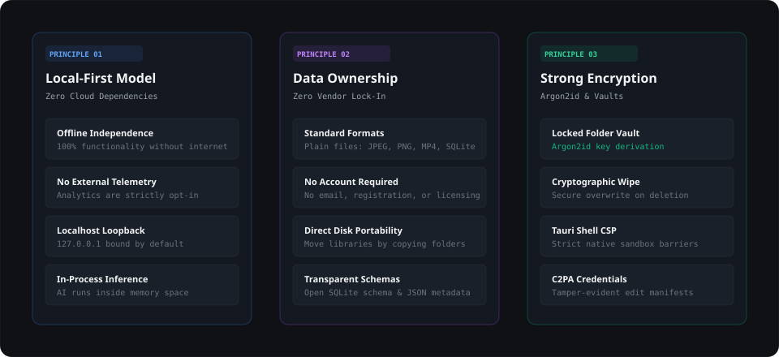
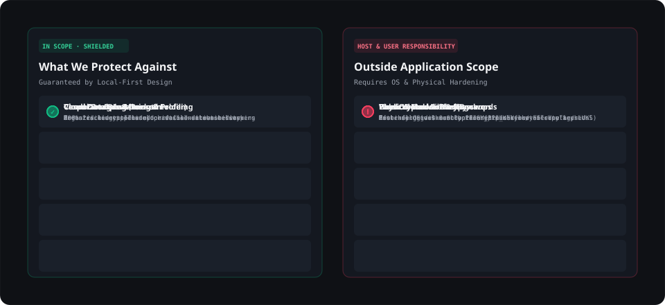

# Security & Privacy

Prism is built with privacy as a core principle. All data stays on your machine, and no information is sent to external services without explicit consent.

## Core Security Principles

<p align="center">
  
</p>

## Locked Folder / Encrypted Vault

### What is the Locked Folder?
Locked Folder provides a protected, access-restricted enclave for your most private photos and videos. Files in the Locked Folder are:

- **Isolated from Queries** — Excluded from general photo queries, FTS5 search indexes, face recognition, and explore views (`is_locked = 0` enforcement).
- **Hidden from UI** — Not visible in the gallery, albums, map, or timeline without active authentication.
- **Passcode Protected** — Verified using memory-hard **Argon2id** key derivation function (KDF) with session-based expiration and rate-limiting against brute force.
- **Dedicated Sessions** — Authenticated viewing tokens automatically expire after 15 minutes of inactivity.
- **Encrypted at Rest** — Locking a photo while the vault is initialized encrypts the original with **AES-256-GCM** (unique 96-bit nonce per file) into a `.prism_enc` sidecar and shreds the plaintext original. Cached plaintext thumbnails are removed as well.
- **Zero-Knowledge Serving** — Vaulted photos are decrypted in memory when served (`GET /photos/:id/file`, `GET /photos/:id/thumbnail`); decrypted data is never written back to disk. Thumbnails for locked photos are generated from decrypted bytes on the fly.
- **Dual-Mode Recovery** — Vault setup produces a downloadable Emergency Recovery Kit (armored recovery token that unwraps the master key and resets the password) and, optionally, an OS keyring escrow token for biometric/system-login unlock.

> [!NOTE]
> **Scope of Protection**: When the vault is initialized, media files locked into the vault are file-level encrypted at rest using AES-256-GCM with keys derived via Argon2id (`vault_initialized` setting gates this behavior). Photos locked before vault setup are protected by database filtering and session gating only; re-locking them after vault setup upgrades them to full encryption. Direct physical disk access by unauthorized local OS users remains best mitigated by host-level full disk encryption (LUKS, FileVault, BitLocker).

### Vault Endpoints

| Endpoint | Purpose |
|----------|---------|
| `POST /api/v1/vault/setup` | Initialize vault: Argon2id salt, wrapped master key, Emergency Recovery Kit, optional OS escrow |
| `POST /api/v1/vault/unlock` | Unlock with password |
| `POST /api/v1/vault/recover` | Unlock with Emergency Recovery Kit token and reset password |
| `POST /api/v1/vault/unlock-escrow` | Unlock via OS keyring escrow token |
| `POST /api/v1/vault/lock` | Lock the vault session |
| `GET /api/v1/vault/status` | Initialization, unlock state, escrow flag, locked photo count |

## API Security

### API Key Authentication

Optional API key protection for the backend:

```bash
# Set API key
export API_KEY=your-secret-key

# Client must include header
X-API-Key: your-secret-key
```

### Rate Limiting

Built-in rate limiting for expensive endpoints:

- **Video endpoints** — 20 requests per minute
- **Inpainting** — 20 requests per minute
- **Per-IP tracking** — Separate limits per client

### CORS Policy

Strict CORS configuration:

```rust
// Allowed origins
- tauri://localhost
- http://tauri.localhost
- http://localhost:3005
- http://127.0.0.1:3005
```

### Content Security Policy (CSP)

Tauri enforces strict CSP:

```
default-src 'self';
img-src 'self' http://127.0.0.1:8269 data: blob:;
media-src 'self' http://127.0.0.1:8269 data: blob:;
style-src 'self' 'unsafe-inline';
script-src 'self';
connect-src 'self' http://127.0.0.1:8269;
```

## Data Storage

### Local Database
- **SQLite** — Stored in `backend_rust/prism.db`
- **WAL Mode** — Write-ahead logging for performance
- **No Remote Sync** — Database never leaves your machine

### Media Files
- **Original Files** — Stored in `uploads/` directory
- **Thumbnails** — Generated and stored in `thumbnails/`
- **Zero Cloud Architecture** — Core media processing, computer vision inference, indexing, and storage require zero cloud services and run completely offline. Optional software updates, model weight packages, and plugin downloads contact external registries only upon explicit user request.

### Local Network Sharing & QR Scope
- **LAN-Only Reachability** — Ephemeral share URLs and Canvas QR codes encode private LAN IPv4 addresses (e.g. `192.168.x.x`). A QR code does not make a private IP internet-accessible; recipients must be connected to the same local Wi-Fi or Ethernet subnet.
- **Discovery vs. Trust** — UDP beacon discovery (port `8272`) broadcasts presence metadata across the LAN to announce reachable instances; it does not grant automatic access. Pairing establishes authenticated peer identities, and file pushes require explicit user initiation.

### Configuration
- **Settings** — Stored in SQLite database
- **Environment Variables** — For sensitive configuration
- **No Cloud Config** — Configuration is local only

## Privacy Features

### No Telemetry by Default
- **Opt-in Only** — Telemetry is disabled by default
- **No Tracking** — No user identification
- **No Analytics** — No usage statistics collected
- **Transparent** — All telemetry code is open source

### Data Export
- **Full Export** — Export all your data at any time
- **No Lock-in** — Your data is always accessible
- **Standard Formats** — Export in common formats (JPEG, MP4, JSON)

### Secure Deletion
- **Trash Purge** — Permanent deletion of trashed files
- **Locked Folder** — Secure wipe of encrypted files
- **Database Cleanup** — Remove metadata permanently

## Threat Model

<p align="center">
  
</p>

## Best Practices

### For Users
1. **Use Strong Passwords** — For Locked Folder and API keys
2. **Encrypt Backups** — When backing up your library
3. **Keep Software Updated** — For security patches
4. **Review Permissions** — Check what Prism can access
5. **Enable Telemetry Only If Needed** — It's off by default

### For Developers
1. **Never Commit Secrets** — Use environment variables
2. **Validate Input** — Sanitize all user input
3. **Use Parameterized Queries** — Prevent SQL injection
4. **Rate Limit Endpoints** — Prevent abuse
5. **Log Security Events** — Track authentication attempts

## Compliance

### GDPR
- **No Personal Data Collection** — We don't collect any data
- **Right to Export** — Full data export capability
- **Right to Delete** — Permanent deletion of all data
- **No Third-party Sharing** — No data is shared

### CCPA
- **No Data Selling** — We never sell your data
- **No Tracking** — No user tracking or profiling
- **Full Control** — Export or delete anytime

## Security Auditing

### Open Source
- **Full Transparency** — All code is public
- **Community Review** — Anyone can audit the code
- **No Backdoors** — No hidden functionality

### Dependencies
- **Minimal Dependencies** — Fewer dependencies = smaller attack surface
- **Regular Updates** — Keep dependencies current
- **Known Vulnerabilities** — Monitor for CVEs

## Reporting Security Issues

If you discover a security vulnerability:

1. **Do Not** open a public issue
2. **Email** security@prism.app (or maintainer email)
3. **Include** detailed reproduction steps
4. **Allow** reasonable time for response

We will:
- Acknowledge receipt within 48 hours
- Provide an initial assessment within 1 week
- Release a fix within 30 days (for critical issues)
- Credit researchers (with permission)

## Security Checklist

- [x] Local-first architecture
- [x] No cloud dependencies
- [x] Encrypted Locked Folder
- [x] API key authentication
- [x] Rate limiting
- [x] Strict CSP
- [x] No telemetry by default
- [x] Data export capability
- [x] Secure deletion
- [x] Open source
